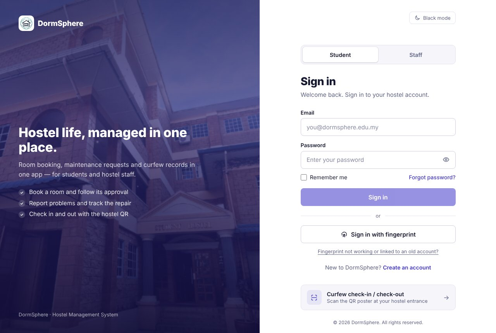
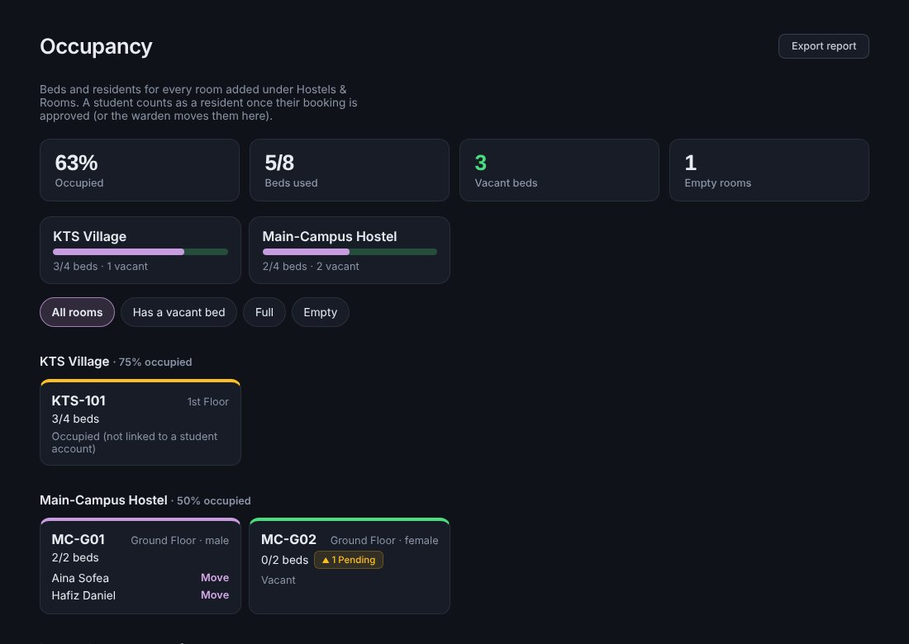
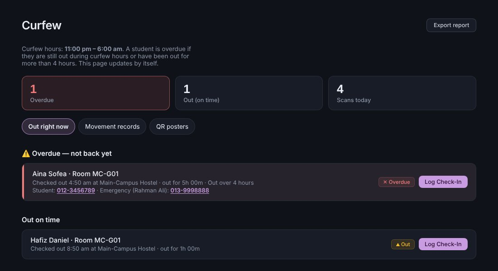
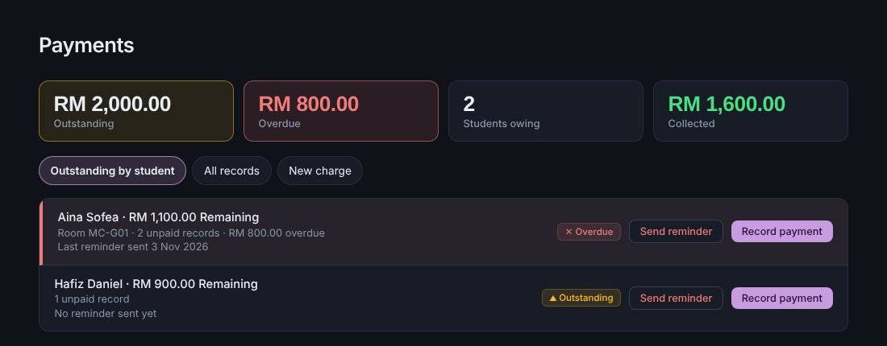
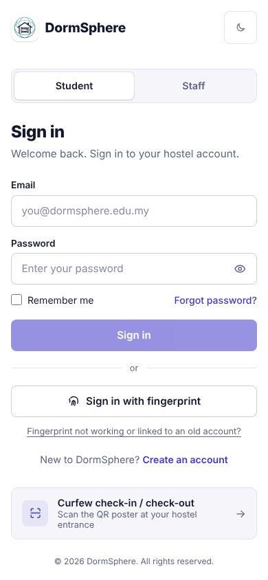

<div align="center">


# DormSphere

**A web-based hostel management system for students and hostel staff**

Room booking · Eligibility checks · Complaints & maintenance · QR curfew monitoring · Role-based dashboards with AI-assisted analytics

[](https://react.dev)
[](https://vite.dev)
[](https://supabase.com)
[](https://hostel-management-systemfyp.vercel.app/)

[**Live demo →**](https://hostel-management-systemfyp.vercel.app/)

</div>

---

## About

In many campus hostels, most of the work is still done by hand or over WhatsApp: room booking and allocation, checking who is eligible for a room, reporting complaints and maintenance, and keeping curfew records. Without one central system it's hard to track room availability, follow up on booking status and repairs, and keep curfew records accurate. Wardens also have no single place to see what's happening across the hostels.

DormSphere puts all of this into one installable web app with a separate dashboard for each role: **students, wardens, finance and technicians**.

<p align="center">
  
</p>

## Goals

1. An integrated system for **room booking** with **automated student eligibility verification**.
2. A **centralised management and reporting module** with role-based dashboards and **AI-assisted analytics** for monitoring and decision-making.
3. Hostel operations tools for **complaint handling, maintenance tracking** and **QR code-based check-in / check-out with curfew monitoring**.

## Features

### 🎓 Student
- Sign up, complete a profile (programme, semester, birthday, emergency contact) and sign in with **email or fingerprint (passkey)**
- Browse hostels → floors → rooms and **request a booking**, then track its approval
- Account verification by Finance before booking opens
- **Submit complaints** with a photo (and mark them urgent), then follow the repair status
- **Curfew check-in / check-out** by scanning the QR poster at the hostel entrance (location-checked)
- Hostel news, **emergency alerts**, a **hostel fee reminder** with the outstanding balance, transport timetable, and a Help Center chat with the warden
- Light / dark mode, notifications, and installable as a phone app (PWA)

### 🛡️ Warden
- **Overview dashboard** with charts, a "needs attention" strip and live updates
- Approve or reject bookings; view student details, eligibility and emergency contacts
- **Occupancy view**: occupied vs vacant beds per hostel, residents per room, and room transfers
- Assign complaints to technicians and track open, urgent and long-running cases
- **Curfew monitoring**: who is out right now, overdue alerts, full movement history and per-hostel QR posters
- Post news and **emergency announcements**; edit the transport timetable; reply in the Help Center
- **AI assistant** that answers questions about hostel data, plus **AI predictions** for planning
- **Activity log** (audit trail) of every important action
- **Export reports** (summary, occupancy, curfew, complaints, bookings) as **PDF, Word or Excel**

### 💳 Finance
- Verify new student accounts
- Add hostel fee charges, record full or partial payments, and see each student's **remaining balance**
- Send **payment reminders** that appear on the student's Home page
- Summary dashboard and exportable payment reports

### 🔧 Technician
- View assigned maintenance requests (with photos)
- Update the status (Pending → In Progress → Completed) and add remarks
- View completed work history

<p align="center">
  
  
</p>
<p align="center">
  
  
</p>
<p align="center"><sub>Screenshots use sample data.</sub></p>

## Tech stack

| Layer | Technology |
| --- | --- |
| Frontend | React 19, Vite 8, plain CSS (light/dark themes) |
| Backend & database | Supabase — PostgreSQL with Row Level Security, Auth, Storage, Realtime |
| Server functions | Supabase Edge Functions (Deno): `ai-summary`, `curfew-scan`, `passkey` |
| AI | Groq API (free tier) for the warden assistant, with Gemini as a fallback |
| Charts & reports | Chart.js, jsPDF + AutoTable, docx, ExcelJS |
| QR & biometrics | `qrcode`, `html5-qrcode`, WebAuthn passkeys (`@simplewebauthn/browser`) |
| Hosting | Vercel (installable PWA with a service worker) |

## Security

- **Row Level Security** on every table: students only see their own records; staff see only what their role needs.
- Role checks happen in the database (`is_warden()`, `is_finance()`, `is_technician()`), not only in the UI.
- Staff sign-up requires a staff code from the hostel office.
- Curfew scans are checked server-side against each hostel's GPS location.
- Important actions are written to an **audit log** by database triggers, and wardens can read but not edit it.
- Inactivity timeout and automatic sign-out when the app is left.

## Getting started

### Prerequisites
- [Node.js](https://nodejs.org) 20 or newer
- A [Supabase](https://supabase.com) project
- (Optional) the [Supabase CLI](https://supabase.com/docs/guides/cli) for deploying edge functions

### 1. Install

```bash
git clone https://github.com/RafAmeer/hostel-management-system.git
cd hostel-management-system
npm install
```

### 2. Environment variables

Create a `.env` file in the project root:

```env
VITE_SUPABASE_URL=https://<your-project>.supabase.co
VITE_SUPABASE_ANON_KEY=<your-anon-key>
```

### 3. Database

Run the SQL files in [`supabase/migrations`](supabase/migrations) in date order using the Supabase SQL editor (or `supabase db push`).

### 4. Edge functions

```bash
supabase functions deploy ai-summary
supabase functions deploy curfew-scan --no-verify-jwt
supabase functions deploy passkey --no-verify-jwt
supabase secrets set GROQ_API_KEY=<your-key>
```

### 5. Run

```bash
npm run dev       # start the dev server
npm run build     # production build
npm run preview   # preview the production build
```

## Project structure

```
├── public/                 # logo, PWA icons, service worker, images
├── src/
│   ├── App.jsx             # auth flow, sign-in page, role routing
│   ├── auth.css            # sign-in page styles
│   ├── pages/              # Student, Warden, Finance, Technician dashboards + curfew scan page
│   ├── components/         # shared UI and dashboard tabs
│   ├── hooks/              # theme, notifications, idle timeout, PWA install …
│   ├── lib/                # Supabase client, analytics, reports, curfew, payments …
│   └── data/               # starter hostel and programme data
├── supabase/
│   ├── migrations/         # database schema, RLS policies, triggers
│   ├── functions/          # edge functions (AI, curfew scan, passkeys)
│   └── templates/          # branded auth email templates
└── docs/screenshots/
```

## Author

Designed and built by **Ashraf Fakhrul Ameeruddin Lizam** ([@RafAmeer](https://github.com/RafAmeer)).

---

<sub>© 2026 DormSphere. Hostel names and room data in the app are sample content for demonstration.</sub>
